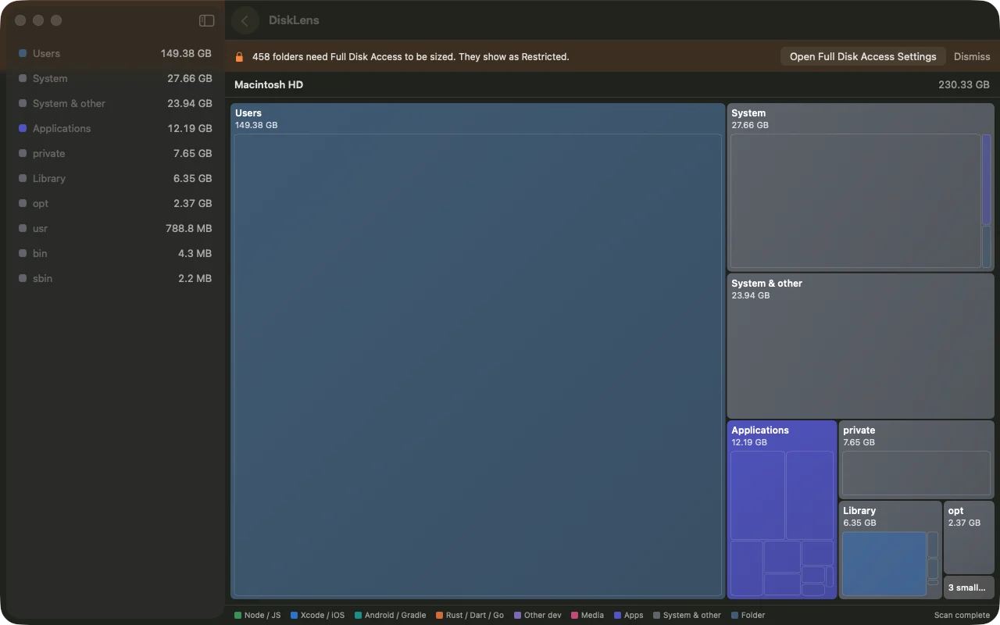
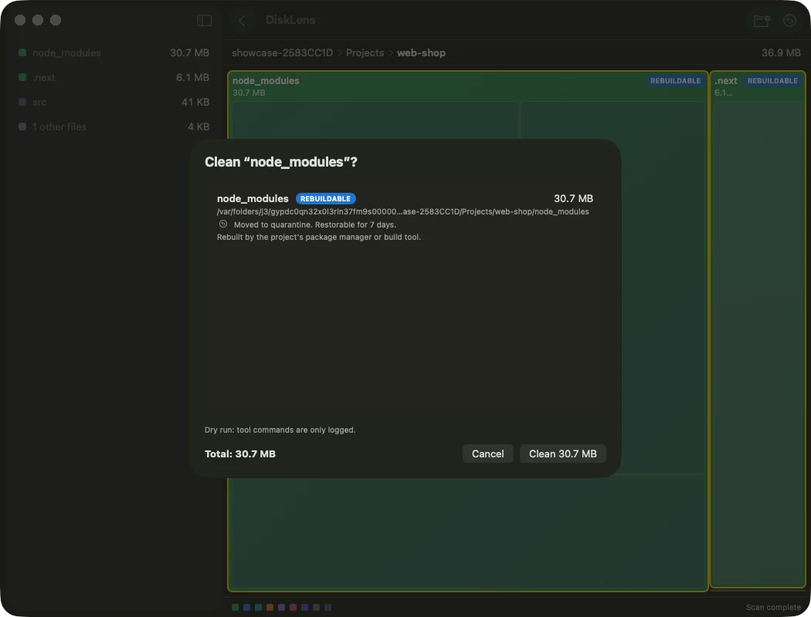
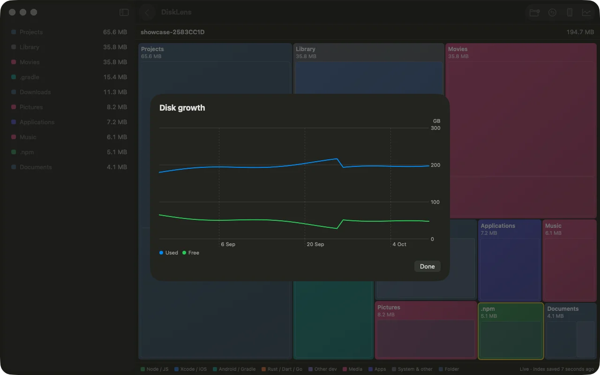
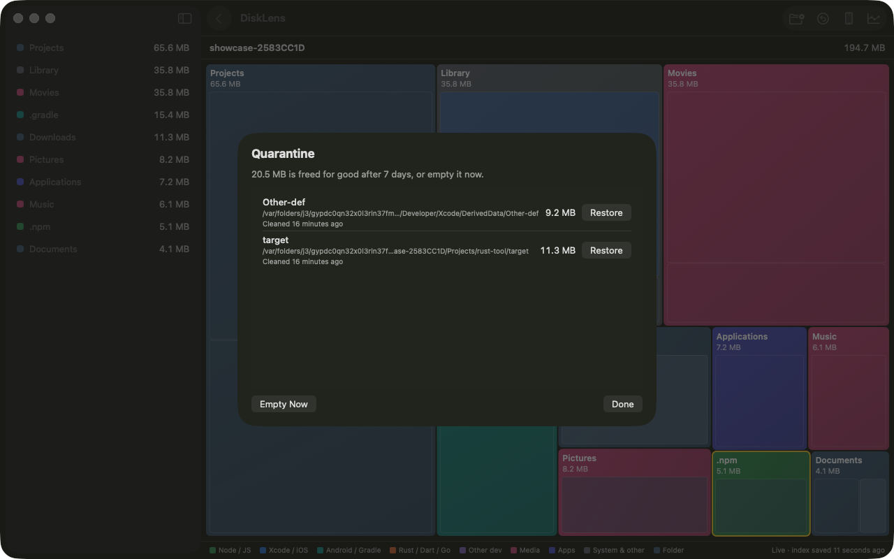
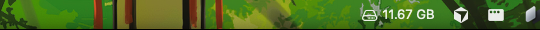

<h1 align="center">DiskLens</h1>
<p align="center"><b>See where your disk went. Clean developer junk without fear.</b></p>
<p align="center">
  <a href="https://github.com/jxngrx/disklens/releases/latest/download/DiskLens.dmg">Download for macOS</a> ·
  <a href="https://jxngrx.github.io/disklens/">Website</a> ·
  <a href="CONTRIBUTING.md">Contributing</a>
</p>



DiskLens is a native macOS app that maps your whole disk as a zoomable treemap, then clears the junk developers collect: Xcode DerivedData, simulators, `node_modules`, Gradle, Pods, Cargo targets, Docker and more. Cleaned items go to a quarantine, so you can undo.

## Features

- **Fast treemap.** First boxes in under a second. A 1.8 M-file scan takes about 12 s, then FSEvents keeps it live.
- **Safe by design.** No root or sudo. Source files are never touched. Every clean is confirmed first and can be restored.
- **Built for developers.** Per-ecosystem cleanup rules, a mobile-dev pack, project view with "last worked on", and Docker awareness.
- **Autopilot.** A menu bar free-space readout, a keep-free daemon, and a growth timeline that shows what ballooned this week.
- **Auto-updates** through Sparkle.

| Confirm before it goes | Watch what grows |
| --- | --- |
|  |  |

| Undo from quarantine | Menu bar |
| --- | --- |
|  |  |

## Install

1. Download [`DiskLens.dmg`](https://github.com/jxngrx/disklens/releases/latest/download/DiskLens.dmg) and drag the app to Applications.
2. To size protected folders, add DiskLens under **System Settings → Privacy & Security → Full Disk Access**, then relaunch. The app links you there when a clean fails for permission.

Requires macOS 14 or later.

## Build from source

```sh
brew install xcodegen
xcodegen generate
xcodebuild -project DiskLens.xcodeproj -scheme DiskLens build
```

Core library and CLI:

```sh
cd Packages/DiskLensCore
swift build && swift test
swift run disklens --help
```

## Project layout

| Path | What it holds |
| --- | --- |
| `App/` | SwiftUI app (treemap, clean sheet, quarantine, menu bar) |
| `Packages/DiskLensCore/` | Scanner, cleanup rules, quarantine, live index, `disklens` CLI |
| `UITests/` | XCUITest navigation and clean flow |
| `site/` | Landing page and Sparkle appcast |
| `SPEC.md`, `plansetup.md` | Product spec and build log |

## Releasing

Pushing a tag such as `v0.1.1` builds, signs and notarizes a DMG, publishes it to Releases and updates the Sparkle appcast.

1. Add repo secrets: `DEVID_P12` (base64 Developer ID Application .p12), `DEVID_P12_PASSWORD`, `SPARKLE_PRIVATE_KEY`, and for notarization `APPLE_ID`, `APPLE_APP_PASSWORD`, `APPLE_TEAM_ID`.
2. Set Settings → Pages → Source to **GitHub Actions**.
3. `git tag v0.1.1 && git push origin v0.1.1`

## Contributing

Issues and pull requests are welcome. See [CONTRIBUTING.md](CONTRIBUTING.md).

---

Built by [jxngrx](https://jxngrx.com) · [X](https://x.com/jxngrx) · [GitHub](https://github.com/jxngrx)
